# AI Mall 独立站商城 V1 技术方案

> 版本：V1.0  
> 更新日期：2026-07-10  
> 状态：设计定稿，待实现

---

## 1. 背景

### 1.1 项目概述

AI Mall 是一个以学习为目的的独立站商城练手项目（毕设方向），整体规划分为两个版本：

| 版本 | 范围 | 状态 |
|------|------|------|
| **V1** | 基础独立站全流程：用户、商品、购物车、订单、营销、数据看板、售后退款 | **本次实现** |
| **V2** | 在 V1 基础上接入 AI 能力：智能导购、搜索&推荐、智能客服、AI 智能工单 | 待 V1 验收后启动 |

V1 目标是在**不引入复杂中间件**的前提下，跑通独立站商城的核心业务闭环。部分流程有意简化（如注册无需邮箱验证、点击支付即视为支付成功），但模块完整、数据模型清晰，为 V2 AI 能力预留扩展点。

### 1.2 项目目标

- 实现 B 端（运营管理）与 C 端（消费者）完整功能
- 支持商品多规格（颜色/尺码）SKU 管理
- 支持 Banner 轮播与满减优惠券营销
- 支持模拟支付、发货履约、退款售后简化流程
- 提供 B 端数据看板（销售统计与图表）
- 到手即用：仅依赖 MySQL、Redis、MinIO 三个中间件

### 1.3 已确认的业务规则

| 规则项 | 决定 |
|--------|------|
| JWT Token 有效期 | 7 天 |
| 订单未支付超时自动取消 | 30 分钟 |
| 退款申请时机 | 已支付后、订单完成前均可申请 |
| 购物车 | 必须登录后才能加购 |
| 营销模块 V1 | Banner + 优惠券（满减） |
| 管理员账号 | 预置 `admin / admin123` |
| 对象存储 | AWS S3 API 对接本地 MinIO |
| 仓库结构 | Monorepo，四子工程 + Maven parent |
| 订单超时机制 | Redis 过期事件（主） + Spring `@Scheduled` 兜底扫描（辅） |
| 服务端口 | B 端：8081（API）/ 8082（前端）；C 端：9091（API）/ 9092（前端） |

---

## 2. 架构设计

### 2.1 系统架构图

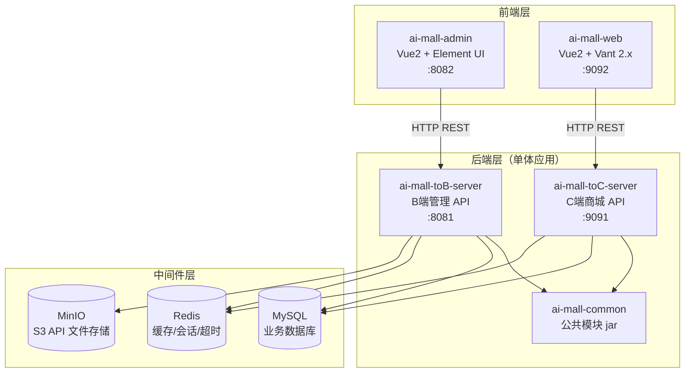

### 2.2 部署拓扑

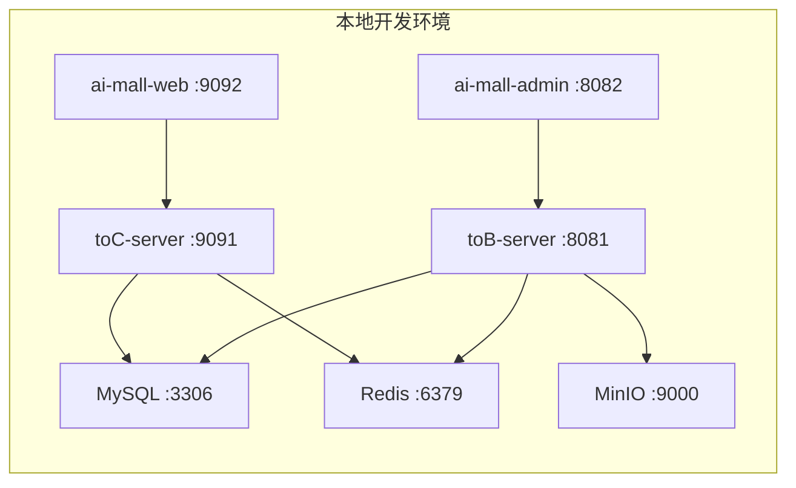

### 2.3 服务端口规划

| 工程 | 端口 | 说明 |
|------|------|------|
| ai-mall-toB-server | **8081** | B 端管理 API，Knife4j 文档：`http://localhost:8081/doc.html` |
| ai-mall-admin | **8082** | B 端管理前端（Vue CLI devServer） |
| ai-mall-toC-server | **9091** | C 端商城 API，Knife4j 文档：`http://localhost:9091/doc.html` |
| ai-mall-web | **9092** | C 端商城前端（Vue CLI devServer） |

> 前端 `vue.config.js` 中通过 `devServer.proxy` 将 API 请求代理到对应后端端口。

### 2.4 B/C 端职责划分

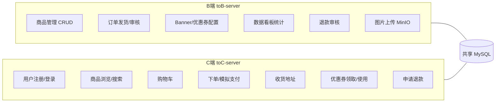

---

## 3. 核心业务流程

### 3.1 用户注册登录流程

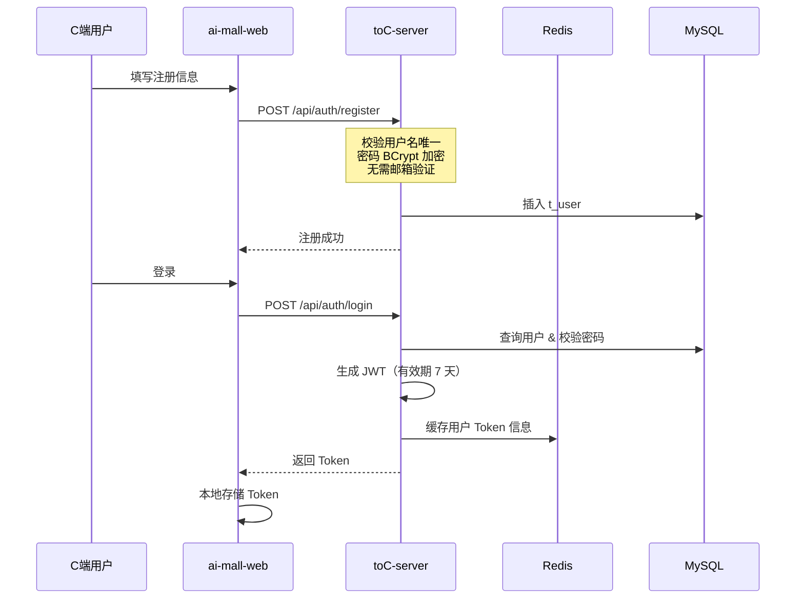

### 3.2 商品浏览与加购流程

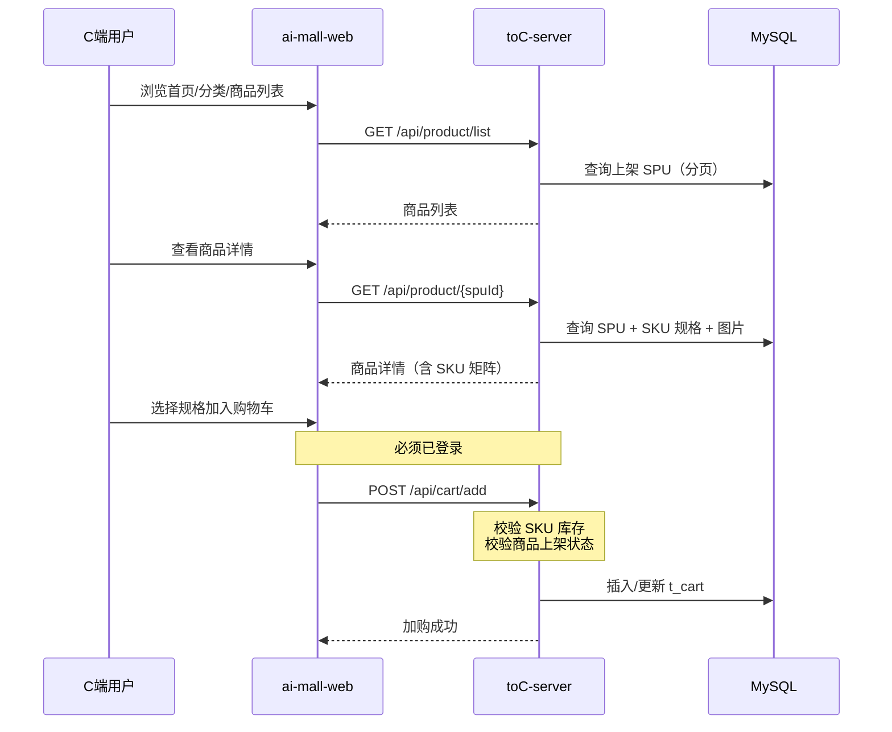

### 3.3 下单与模拟支付流程

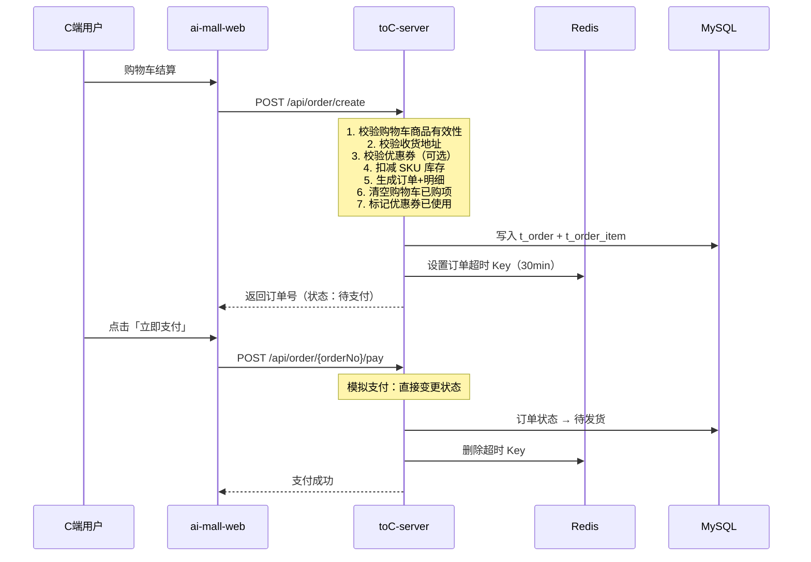

### 3.4 订单超时自动取消

采用 **双机制** 保障可靠性：Redis 过期事件为主路径，Spring `@Scheduled` 定时扫描为兜底。

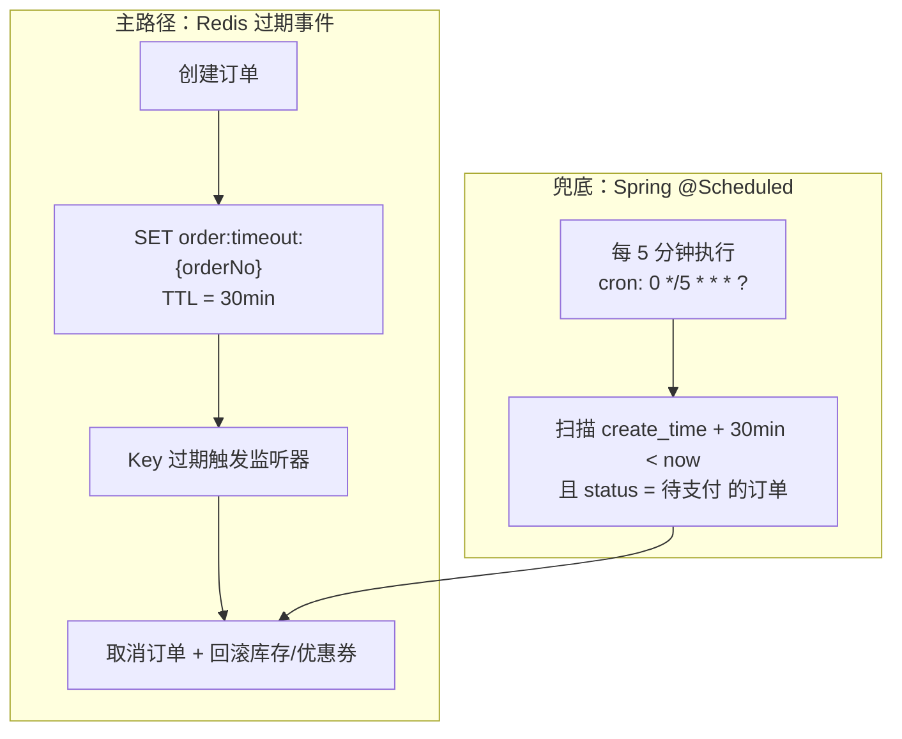

#### 3.4.1 主路径 — Redis 过期事件

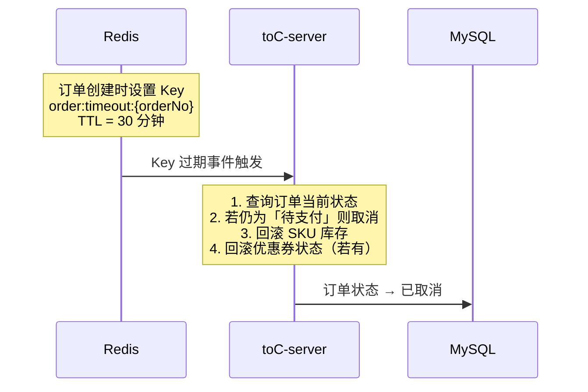

> Redis 需开启 `notify-keyspace-events Ex`（或 `AKE`），由 `RedisConfig` 启动时配置。

#### 3.4.2 兜底 — Spring @Scheduled 定时扫描

当 Redis 过期事件丢失（如监听器短暂宕机）时，定时任务补偿取消漏网订单。

```java
/**
 * 订单超时兜底扫描
 *
 * 流程说明：
 * 1. 每 5 分钟触发一次
 * 2. 查询 create_time + 30min < 当前时间 且 status = 待支付 的订单
 * 3. 逐笔执行取消逻辑（与 Redis 过期监听器共用 OrderService.cancelExpiredOrder）
 * 4. 幂等处理：已为终态的订单跳过
 */
@Scheduled(cron = "0 */5 * * * ?")
public void scanExpiredOrders() { ... }
```

| 项 | 约定 |
|----|------|
| 实现位置 | toC-server（`schedule/OrderTimeoutScheduleTask.java`） |
| 技术栈 | Spring Boot 内置 `@Scheduled` + `@EnableScheduling` |
| 执行频率 | 每 5 分钟 |
| 取消逻辑 | 与 Redis 监听器共用同一 Service 方法，保证幂等 |

### 3.5 发货履约流程

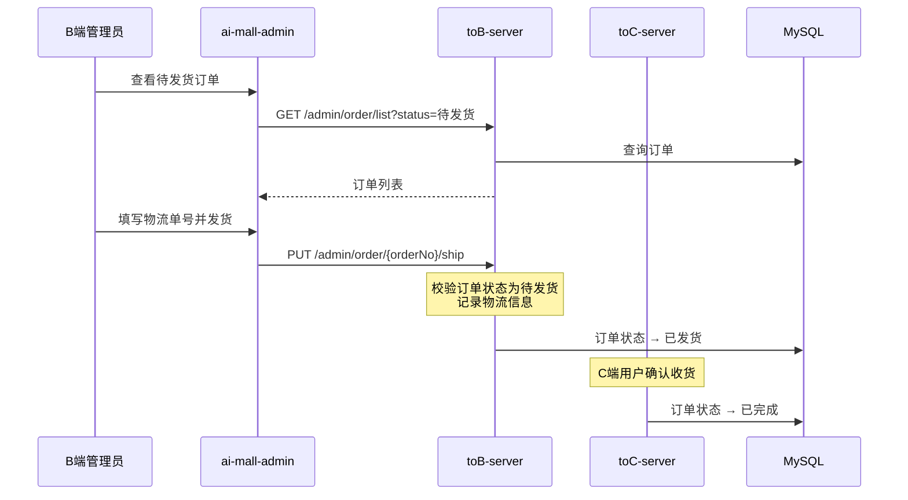

### 3.6 退款申请流程

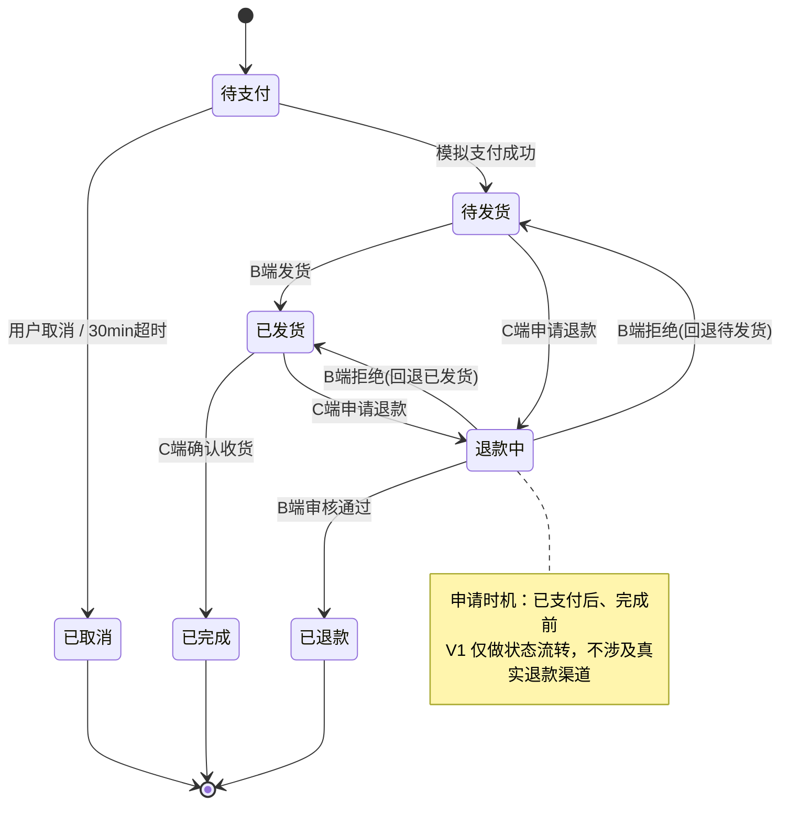

### 3.7 优惠券使用流程

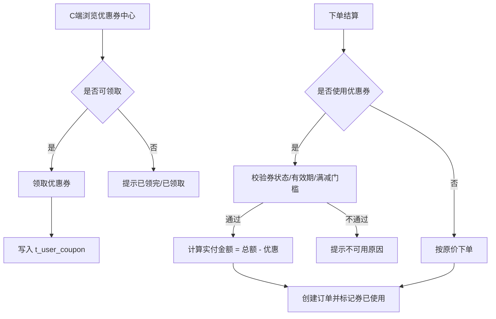

---

## 4. API 接口设计

### 4.1 通用约定

| 项 | 约定 |
|----|------|
| 协议 | HTTP/HTTPS |
| 数据格式 | JSON |
| 字符编码 | UTF-8 |
| C 端前缀 | `/api/` |
| B 端前缀 | `/admin/` |
| 认证方式 | JWT Bearer Token（Header: `Authorization: Bearer {token}`） |
| 响应体 | 统一 `Result<T>` 结构 |
| 分页 | `pageNum` + `pageSize`，基于 PageHelper |
| API 文档 | Knife4j（Swagger），访问 `/doc.html` |

**统一响应体：**

```json
{
  "code": 200,
  "message": "success",
  "data": {}
}
```

**常见错误码：**

| code | 说明 |
|------|------|
| 200 | 成功 |
| 400 | 请求参数错误 |
| 401 | 未登录或 Token 过期 |
| 403 | 无权限 |
| 404 | 资源不存在 |
| 500 | 服务器内部错误 |

### 4.2 C 端接口（toC-server :9091）

#### 认证模块

| 方法 | 路径 | 说明 | 鉴权 |
|------|------|------|------|
| POST | `/api/auth/register` | 用户注册 | 否 |
| POST | `/api/auth/login` | 用户登录，返回 JWT | 否 |
| POST | `/api/auth/logout` | 退出登录 | 是 |

#### 用户模块

| 方法 | 路径 | 说明 | 鉴权 |
|------|------|------|------|
| GET | `/api/user/info` | 获取当前用户信息 | 是 |
| PUT | `/api/user/info` | 修改个人资料 | 是 |
| PUT | `/api/user/password` | 修改密码 | 是 |

#### 收货地址

| 方法 | 路径 | 说明 | 鉴权 |
|------|------|------|------|
| GET | `/api/address/list` | 地址列表 | 是 |
| POST | `/api/address` | 新增地址 | 是 |
| PUT | `/api/address/{id}` | 修改地址 | 是 |
| DELETE | `/api/address/{id}` | 删除地址 | 是 |
| PUT | `/api/address/{id}/default` | 设为默认地址 | 是 |

#### 商品模块

| 方法 | 路径 | 说明 | 鉴权 |
|------|------|------|------|
| GET | `/api/category/tree` | 分类树 | 否 |
| GET | `/api/product/list` | 商品列表（分页、分类筛选） | 否 |
| GET | `/api/product/search` | 商品搜索（关键词） | 否 |
| GET | `/api/product/{spuId}` | 商品详情（含 SKU） | 否 |
| GET | `/api/banner/list` | 首页轮播列表 | 否 |

#### 购物车

| 方法 | 路径 | 说明 | 鉴权 |
|------|------|------|------|
| GET | `/api/cart/list` | 购物车列表 | 是 |
| POST | `/api/cart/add` | 加入购物车 | 是 |
| PUT | `/api/cart/update` | 修改数量 | 是 |
| DELETE | `/api/cart/{id}` | 删除购物车项 | 是 |
| DELETE | `/api/cart/clear` | 清空购物车 | 是 |

#### 订单模块

| 方法 | 路径 | 说明 | 鉴权 |
|------|------|------|------|
| POST | `/api/order/create` | 创建订单 | 是 |
| POST | `/api/order/{orderNo}/pay` | 模拟支付 | 是 |
| POST | `/api/order/{orderNo}/cancel` | 取消订单 | 是 |
| GET | `/api/order/list` | 我的订单列表 | 是 |
| GET | `/api/order/{orderNo}` | 订单详情 | 是 |
| PUT | `/api/order/{orderNo}/confirm` | 确认收货 | 是 |

#### 优惠券

| 方法 | 路径 | 说明 | 鉴权 |
|------|------|------|------|
| GET | `/api/coupon/list` | 可领取优惠券列表 | 是 |
| POST | `/api/coupon/{couponId}/receive` | 领取优惠券 | 是 |
| GET | `/api/coupon/my` | 我的优惠券 | 是 |

#### 售后退款

| 方法 | 路径 | 说明 | 鉴权 |
|------|------|------|------|
| POST | `/api/refund/apply` | 申请退款 | 是 |
| GET | `/api/refund/list` | 我的退款列表 | 是 |
| GET | `/api/refund/{id}` | 退款详情 | 是 |

### 4.3 B 端接口（toB-server :8081）

#### 认证模块

| 方法 | 路径 | 说明 | 鉴权 |
|------|------|------|------|
| POST | `/admin/auth/login` | 管理员登录 | 否 |
| POST | `/admin/auth/logout` | 退出登录 | 是 |

#### 商品管理

| 方法 | 路径 | 说明 | 鉴权 |
|------|------|------|------|
| GET | `/admin/category/tree` | 分类树 | 是 |
| POST | `/admin/category` | 新增分类 | 是 |
| PUT | `/admin/category/{id}` | 修改分类 | 是 |
| DELETE | `/admin/category/{id}` | 删除分类 | 是 |
| GET | `/admin/product/list` | 商品列表（分页） | 是 |
| POST | `/admin/product` | 新增商品（SPU+SKU） | 是 |
| PUT | `/admin/product/{spuId}` | 修改商品 | 是 |
| PUT | `/admin/product/{spuId}/status` | 上下架 | 是 |
| GET | `/admin/product/{spuId}` | 商品详情 | 是 |

#### 文件上传

| 方法 | 路径 | 说明 | 鉴权 |
|------|------|------|------|
| POST | `/admin/file/upload` | 上传图片到 MinIO | 是 |

#### 订单管理

| 方法 | 路径 | 说明 | 鉴权 |
|------|------|------|------|
| GET | `/admin/order/list` | 订单列表（分页、状态筛选） | 是 |
| GET | `/admin/order/{orderNo}` | 订单详情 | 是 |
| PUT | `/admin/order/{orderNo}/ship` | 发货（填物流单号） | 是 |

#### Banner 管理

| 方法 | 路径 | 说明 | 鉴权 |
|------|------|------|------|
| GET | `/admin/banner/list` | Banner 列表 | 是 |
| POST | `/admin/banner` | 新增 Banner | 是 |
| PUT | `/admin/banner/{id}` | 修改 Banner | 是 |
| DELETE | `/admin/banner/{id}` | 删除 Banner | 是 |
| PUT | `/admin/banner/{id}/status` | 启用/禁用 | 是 |

#### 优惠券管理

| 方法 | 路径 | 说明 | 鉴权 |
|------|------|------|------|
| GET | `/admin/coupon/list` | 优惠券模板列表 | 是 |
| POST | `/admin/coupon` | 创建优惠券 | 是 |
| PUT | `/admin/coupon/{id}` | 修改优惠券 | 是 |
| PUT | `/admin/coupon/{id}/status` | 启用/停用 | 是 |

#### 退款审核

| 方法 | 路径 | 说明 | 鉴权 |
|------|------|------|------|
| GET | `/admin/refund/list` | 退款申请列表 | 是 |
| PUT | `/admin/refund/{id}/approve` | 审核通过 | 是 |
| PUT | `/admin/refund/{id}/reject` | 审核拒绝 | 是 |

#### 数据看板

| 方法 | 路径 | 说明 | 鉴权 |
|------|------|------|------|
| GET | `/admin/dashboard/overview` | 今日概览（订单数/销售额/新增用户/待发货） | 是 |
| GET | `/admin/dashboard/sales-trend` | 销售趋势（近7/30天） | 是 |
| GET | `/admin/dashboard/product-rank` | 商品销量 TOP10 | 是 |
| GET | `/admin/dashboard/order-status` | 订单状态分布 | 是 |

---

## 5. 数据库设计

### 5.1 ER 图

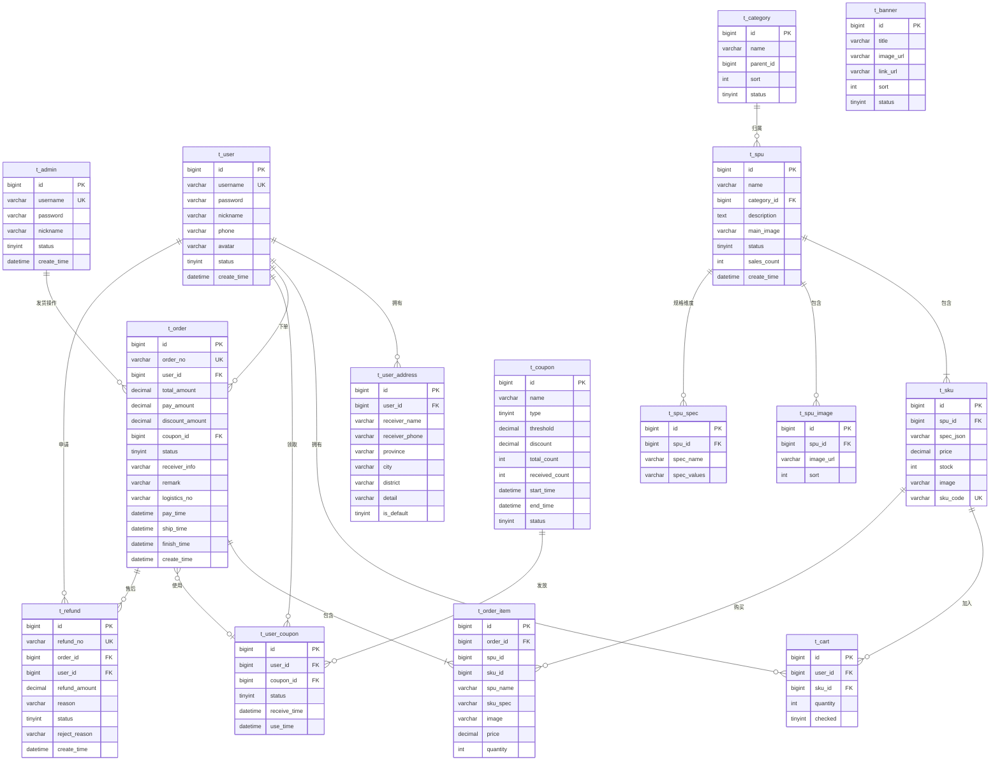

### 5.2 表结构详细设计

#### t_admin（管理员表）

| 字段 | 类型 | 说明 |
|------|------|------|
| id | BIGINT PK AUTO_INCREMENT | 主键 |
| username | VARCHAR(64) UNIQUE NOT NULL | 用户名 |
| password | VARCHAR(128) NOT NULL | BCrypt 加密密码 |
| nickname | VARCHAR(64) | 昵称 |
| status | TINYINT DEFAULT 1 | 1=启用 0=禁用 |
| create_time | DATETIME | 创建时间 |
| update_time | DATETIME | 更新时间 |

#### t_user（C 端用户表）

| 字段 | 类型 | 说明 |
|------|------|------|
| id | BIGINT PK AUTO_INCREMENT | 主键 |
| username | VARCHAR(64) UNIQUE NOT NULL | 用户名 |
| password | VARCHAR(128) NOT NULL | BCrypt 加密密码 |
| nickname | VARCHAR(64) | 昵称 |
| phone | VARCHAR(20) | 手机号 |
| avatar | VARCHAR(256) | 头像 URL |
| status | TINYINT DEFAULT 1 | 1=正常 0=禁用 |
| create_time | DATETIME | 注册时间 |
| update_time | DATETIME | 更新时间 |

#### t_user_address（收货地址表）

| 字段 | 类型 | 说明 |
|------|------|------|
| id | BIGINT PK AUTO_INCREMENT | 主键 |
| user_id | BIGINT NOT NULL | 用户 ID |
| receiver_name | VARCHAR(64) NOT NULL | 收货人 |
| receiver_phone | VARCHAR(20) NOT NULL | 收货电话 |
| province | VARCHAR(32) | 省 |
| city | VARCHAR(32) | 市 |
| district | VARCHAR(32) | 区 |
| detail | VARCHAR(256) NOT NULL | 详细地址 |
| is_default | TINYINT DEFAULT 0 | 1=默认地址 |
| create_time | DATETIME | 创建时间 |

#### t_category（商品分类表）

| 字段 | 类型 | 说明 |
|------|------|------|
| id | BIGINT PK AUTO_INCREMENT | 主键 |
| name | VARCHAR(64) NOT NULL | 分类名称 |
| parent_id | BIGINT DEFAULT 0 | 父分类 ID，0=顶级 |
| sort | INT DEFAULT 0 | 排序值 |
| status | TINYINT DEFAULT 1 | 1=启用 0=禁用 |
| create_time | DATETIME | 创建时间 |

#### t_spu（商品主体表）

| 字段 | 类型 | 说明 |
|------|------|------|
| id | BIGINT PK AUTO_INCREMENT | 主键 |
| name | VARCHAR(128) NOT NULL | 商品名称 |
| category_id | BIGINT NOT NULL | 分类 ID |
| description | TEXT | 商品描述 |
| main_image | VARCHAR(256) | 主图 URL |
| status | TINYINT DEFAULT 0 | 0=下架 1=上架 |
| sales_count | INT DEFAULT 0 | 累计销量 |
| create_time | DATETIME | 创建时间 |
| update_time | DATETIME | 更新时间 |

#### t_sku（商品规格表）

| 字段 | 类型 | 说明 |
|------|------|------|
| id | BIGINT PK AUTO_INCREMENT | 主键 |
| spu_id | BIGINT NOT NULL | 所属 SPU |
| spec_json | VARCHAR(512) NOT NULL | 规格 JSON，如 `{"颜色":"红","尺码":"M"}` |
| price | DECIMAL(10,2) NOT NULL | 售价 |
| stock | INT NOT NULL DEFAULT 0 | 库存 |
| image | VARCHAR(256) | SKU 图片 |
| sku_code | VARCHAR(64) UNIQUE | SKU 编码 |

#### t_spu_spec（SPU 规格维度表）

| 字段 | 类型 | 说明 |
|------|------|------|
| id | BIGINT PK AUTO_INCREMENT | 主键 |
| spu_id | BIGINT NOT NULL | 所属 SPU |
| spec_name | VARCHAR(32) NOT NULL | 规格名（颜色/尺码） |
| spec_values | VARCHAR(512) NOT NULL | 可选值，逗号分隔（红,蓝,绿） |

#### t_spu_image（商品图片表）

| 字段 | 类型 | 说明 |
|------|------|------|
| id | BIGINT PK AUTO_INCREMENT | 主键 |
| spu_id | BIGINT NOT NULL | 所属 SPU |
| image_url | VARCHAR(256) NOT NULL | 图片 URL |
| sort | INT DEFAULT 0 | 排序 |

#### t_cart（购物车表）

| 字段 | 类型 | 说明 |
|------|------|------|
| id | BIGINT PK AUTO_INCREMENT | 主键 |
| user_id | BIGINT NOT NULL | 用户 ID |
| sku_id | BIGINT NOT NULL | SKU ID |
| quantity | INT NOT NULL DEFAULT 1 | 数量 |
| checked | TINYINT DEFAULT 1 | 1=选中 0=未选中 |
| create_time | DATETIME | 加入时间 |
| update_time | DATETIME | 更新时间 |

> 唯一索引：`uk_user_sku(user_id, sku_id)`

#### t_order（订单表）

| 字段 | 类型 | 说明 |
|------|------|------|
| id | BIGINT PK AUTO_INCREMENT | 主键 |
| order_no | VARCHAR(32) UNIQUE NOT NULL | 订单编号 |
| user_id | BIGINT NOT NULL | 用户 ID |
| total_amount | DECIMAL(10,2) NOT NULL | 商品总额 |
| discount_amount | DECIMAL(10,2) DEFAULT 0 | 优惠金额 |
| pay_amount | DECIMAL(10,2) NOT NULL | 实付金额 |
| coupon_id | BIGINT | 使用的用户券 ID |
| status | TINYINT NOT NULL | 见订单状态枚举 |
| receiver_info | VARCHAR(512) NOT NULL | 收货信息 JSON 快照 |
| remark | VARCHAR(256) | 买家备注 |
| logistics_no | VARCHAR(64) | 物流单号 |
| pay_time | DATETIME | 支付时间 |
| ship_time | DATETIME | 发货时间 |
| finish_time | DATETIME | 完成时间 |
| create_time | DATETIME | 下单时间 |
| update_time | DATETIME | 更新时间 |

**订单状态枚举（t_order.status）：**

| 值 | 状态 | 说明 |
|----|------|------|
| 0 | 待支付 | 创建后初始状态 |
| 1 | 待发货 | 模拟支付成功 |
| 2 | 已发货 | B 端已发货 |
| 3 | 已完成 | 用户确认收货 |
| 4 | 已取消 | 用户取消或超时 |
| 5 | 退款中 | 用户申请退款 |
| 6 | 已退款 | 退款审核通过 |

#### t_order_item（订单明细表）

| 字段 | 类型 | 说明 |
|------|------|------|
| id | BIGINT PK AUTO_INCREMENT | 主键 |
| order_id | BIGINT NOT NULL | 订单 ID |
| spu_id | BIGINT NOT NULL | SPU ID |
| sku_id | BIGINT NOT NULL | SKU ID |
| spu_name | VARCHAR(128) | 商品名称快照 |
| sku_spec | VARCHAR(256) | 规格快照 |
| image | VARCHAR(256) | 商品图片快照 |
| price | DECIMAL(10,2) NOT NULL | 成交单价 |
| quantity | INT NOT NULL | 购买数量 |

#### t_banner（轮播图表）

| 字段 | 类型 | 说明 |
|------|------|------|
| id | BIGINT PK AUTO_INCREMENT | 主键 |
| title | VARCHAR(128) | 标题 |
| image_url | VARCHAR(256) NOT NULL | 图片 URL |
| link_url | VARCHAR(256) | 跳转链接 |
| sort | INT DEFAULT 0 | 排序 |
| status | TINYINT DEFAULT 1 | 1=启用 0=禁用 |
| create_time | DATETIME | 创建时间 |

#### t_coupon（优惠券模板表）

| 字段 | 类型 | 说明 |
|------|------|------|
| id | BIGINT PK AUTO_INCREMENT | 主键 |
| name | VARCHAR(128) NOT NULL | 券名称 |
| type | TINYINT DEFAULT 1 | 1=满减券 |
| threshold | DECIMAL(10,2) NOT NULL | 满减门槛 |
| discount | DECIMAL(10,2) NOT NULL | 减免金额 |
| total_count | INT NOT NULL | 发放总量 |
| received_count | INT DEFAULT 0 | 已领取数 |
| start_time | DATETIME NOT NULL | 有效期开始 |
| end_time | DATETIME NOT NULL | 有效期结束 |
| status | TINYINT DEFAULT 1 | 1=启用 0=停用 |
| create_time | DATETIME | 创建时间 |

#### t_user_coupon（用户优惠券表）

| 字段 | 类型 | 说明 |
|------|------|------|
| id | BIGINT PK AUTO_INCREMENT | 主键 |
| user_id | BIGINT NOT NULL | 用户 ID |
| coupon_id | BIGINT NOT NULL | 券模板 ID |
| status | TINYINT DEFAULT 0 | 0=未使用 1=已使用 2=已过期 |
| receive_time | DATETIME | 领取时间 |
| use_time | DATETIME | 使用时间 |

#### t_refund（退款申请表）

| 字段 | 类型 | 说明 |
|------|------|------|
| id | BIGINT PK AUTO_INCREMENT | 主键 |
| refund_no | VARCHAR(32) UNIQUE NOT NULL | 退款单号 |
| order_id | BIGINT NOT NULL | 关联订单 |
| user_id | BIGINT NOT NULL | 申请用户 |
| refund_amount | DECIMAL(10,2) NOT NULL | 退款金额 |
| reason | VARCHAR(256) NOT NULL | 退款原因 |
| status | TINYINT DEFAULT 0 | 0=待审核 1=已通过 2=已拒绝 |
| reject_reason | VARCHAR(256) | 拒绝原因 |
| create_time | DATETIME | 申请时间 |
| update_time | DATETIME | 更新时间 |

---

## 6. 工程目录设计

### 6.1 Monorepo 总览

```
ai-mall-server/                          # Git 根目录 / Maven parent
├── pom.xml                              # 父 POM（packaging: pom）
├── README.md                            # 项目说明 & 启动指南
│
├── ai-mall-common/                      # 公共模块
├── ai-mall-toB-server/                  # B端后端
├── ai-mall-toC-server/                  # C端后端
├── ai-mall-admin/                       # B端前端
├── ai-mall-web/                         # C端前端
│
├── docs/                                # 文档
│   ├── V1-技术方案.md                    # 本文档
│   └── sql/
│       └── init.sql                     # 建表 + 预置数据
│
└── openspec/                            # OpenSpec 规范驱动
    └── config.yaml
```

### 6.2 ai-mall-common 目录

```
ai-mall-common/
├── pom.xml
└── src/main/java/com/aimall/common/
    ├── constant/                        # 业务常量
    │   ├── OrderStatus.java             # 订单状态枚举
    │   ├── CouponStatus.java            # 优惠券状态枚举
    │   └── RedisKeyConstant.java        # Redis Key 常量
    ├── entity/                          # 数据库实体（与表一一对应）
    │   ├── User.java
    │   ├── Spu.java
    │   ├── Sku.java
    │   ├── Order.java
    │   └── ...
    ├── dto/                             # 数据传输对象
    ├── vo/                              # 视图对象
    ├── result/                          # 统一响应
    │   ├── Result.java
    │   └── ResultCode.java
    ├── exception/                       # 自定义异常
    │   ├── BusinessException.java
    │   └── GlobalExceptionHandler.java
    └── util/                            # 工具类
        ├── JwtUtil.java
        ├── MinioUtil.java               # S3 API 封装
        └── RedisUtil.java
```

### 6.3 ai-mall-toB-server 目录

```
ai-mall-toB-server/
├── pom.xml
└── src/main/
    ├── java/com/aimall/tob/
    │   ├── ToBApplication.java          # 启动类
    │   ├── config/
    │   │   ├── WebMvcConfig.java
    │   │   ├── SwaggerConfig.java       # Knife4j 配置
    │   │   ├── RedisConfig.java
    │   │   └── MinioConfig.java
    │   ├── interceptor/
    │   │   └── AdminAuthInterceptor.java
    │   ├── controller/
    │   │   ├── AdminAuthController.java
    │   │   ├── ProductController.java
    │   │   ├── OrderController.java
    │   │   ├── BannerController.java
    │   │   ├── CouponController.java
    │   │   ├── RefundController.java
    │   │   ├── DashboardController.java
    │   │   └── FileController.java
    │   ├── service/
    │   │   ├── impl/
    │   │   └── ...
    │   └── mapper/
    │       └── ...
    └── resources/
        ├── application.yml
        ├── application-dev.yml
        └── mapper/                      # MyBatis XML
            ├── ProductMapper.xml
            └── ...
```

### 6.4 ai-mall-toC-server 目录

```
ai-mall-toC-server/
├── pom.xml
└── src/main/
    ├── java/com/aimall/toc/
    │   ├── ToCApplication.java
    │   ├── config/
    │   ├── interceptor/
    │   │   └── UserAuthInterceptor.java
    │   ├── controller/
    │   │   ├── AuthController.java
    │   │   ├── UserController.java
    │   │   ├── AddressController.java
    │   │   ├── ProductController.java
    │   │   ├── CartController.java
    │   │   ├── OrderController.java
    │   │   ├── CouponController.java
    │   │   ├── RefundController.java
    │   │   └── BannerController.java
    │   ├── service/
    │   │   ├── impl/
    │   │   │   ├── OrderServiceImpl.java   # 核心：创建订单、支付
    │   │   │   └── ...
    │   │   └── ...
    │   ├── mapper/
    │   ├── listener/
    │   │   └── OrderTimeoutListener.java   # Redis 过期：订单超时取消（主路径）
    │   └── schedule/
    │       └── OrderTimeoutScheduleTask.java  # @Scheduled 兜底扫描
    └── resources/
        ├── application.yml
        ├── application-dev.yml
        └── mapper/
```

### 6.5 前端工程目录

```
ai-mall-admin/                           # B端管理前端
├── package.json
├── vue.config.js
└── src/
    ├── api/                             # 接口请求封装
    ├── views/
    │   ├── login/
    │   ├── dashboard/                   # 数据看板
    │   ├── product/                     # 商品管理
    │   ├── order/                       # 订单管理
    │   ├── marketing/                   # Banner + 优惠券
    │   └── refund/                      # 退款审核
    ├── router/
    ├── store/
    └── utils/

ai-mall-web/                             # C端商城前端
├── package.json
├── vue.config.js
└── src/
    ├── api/
    ├── views/
    │   ├── home/                        # 首页
    │   ├── category/                    # 分类
    │   ├── product/                     # 商品详情
    │   ├── cart/                        # 购物车
    │   ├── order/                       # 下单/订单
    │   ├── user/                        # 个人中心
    │   ├── coupon/                      # 优惠券
    │   └── refund/                      # 退款
    ├── components/
    │   └── SkuSelector.vue              # SKU 规格选择器
    ├── router/
    ├── store/
    └── utils/
```

---

## 7. 技术栈设计

### 7.1 技术栈总览

```mermaid
graph TB
    subgraph Backend["后端技术栈"]
        direction TB
        B1["Java 11"]
        B2["Spring Boot 2.6"]
        B3["Spring MVC"]
        B4["MyBatis 3.5 + PageHelper"]
        B5["MySQL 8"]
        B6["Redis"]
        B7["Lombok"]
        B8["Hutool"]
        B9["Knife4j (Swagger)"]
        B10["AWS S3 SDK → MinIO"]
        B11["JJWT"]
        B12["Spring @Scheduled"]
    end

    subgraph FrontendB["B端前端"]
        direction TB
        F1["Vue 2.6"]
        F2["Element UI 2.x"]
        F3["Vue Router"]
        F4["Vuex"]
        F5["Axios"]
        F6["ECharts"]
    end

    subgraph FrontendC["C端前端"]
        direction TB
        C1["Vue 2.6"]
        C2["Vant 2.x"]
        C3["Vue Router"]
        C4["Vuex"]
        C5["Axios"]
    end
```

### 7.2 后端依赖版本

| 依赖 | 版本 | 用途 |
|------|------|------|
| Java | 11 | 运行环境 |
| Spring Boot | 2.6.15 | 应用框架 |
| MyBatis Spring Boot Starter | 2.2.2 | ORM |
| PageHelper | 1.4.7 | 分页插件 |
| MySQL Connector | 8.0.33 | 数据库驱动 |
| Spring Boot Starter Data Redis | 2.6.15 | Redis |
| Lombok | 1.18.30 | 简化代码 |
| Hutool | 5.8.25 | 工具库 |
| Knife4j | 3.0.3 | API 文档 |
| AWS Java SDK S3 | 1.12.x | MinIO 文件存储 |
| JJWT | 0.9.1 | JWT 认证 |
| BCrypt (Spring Security Crypto) | — | 密码加密 |

### 7.3 前端依赖版本

| 依赖 | B端 (admin) | C端 (web) |
|------|-------------|-----------|
| Vue | 2.6.14 | 2.6.14 |
| UI 框架 | Element UI 2.15.x | Vant 2.12.x |
| Vue Router | 3.5.x | 3.5.x |
| Vuex | 3.6.x | 3.6.x |
| Axios | 0.27.x | 0.27.x |
| ECharts | 5.4.x | — |

### 7.4 中间件要求

| 中间件 | 版本建议 | 用途 |
|--------|----------|------|
| MySQL | 8.0+ | 业务数据存储 |
| Redis | 6.0+ | Token 缓存、订单超时、热点数据缓存 |
| MinIO | latest | 图片/文件对象存储（S3 兼容 API） |

### 7.5 定时任务说明

| 场景 | 实现方式 | 所在服务 |
|------|----------|----------|
| 订单超时取消（主） | Redis Key 过期事件 + Listener | toC-server |
| 订单超时取消（兜底） | Spring `@Scheduled`，每 5 分钟扫描 | toC-server |
| 优惠券过期 | 懒校验（查询/使用时判断有效期） | toC-server |
| JWT 失效 | Token `exp` 字段校验 | toB / toC |

> V1 不引入 Quartz、XXL-JOB 等外部调度框架，`@Scheduled` 为 Spring Boot 内置能力，零额外依赖。

### 7.6 配置示例

**toB-server application-dev.yml：**

```yaml
server:
  port: 8081

spring:
  datasource:
    url: jdbc:mysql://127.0.0.1:3306/ai_mall?useUnicode=true&characterEncoding=utf-8&serverTimezone=Asia/Shanghai
    username: root
    password: root
    driver-class-name: com.mysql.cj.jdbc.Driver
  redis:
    host: 127.0.0.1
    port: 6379
    database: 0

mybatis:
  mapper-locations: classpath:mapper/*.xml
  configuration:
    map-underscore-to-camel-case: true

pagehelper:
  helper-dialect: mysql
  reasonable: true

jwt:
  secret: ai-mall-jwt-secret-key-2026
  expiration: 604800000  # 7天（毫秒）

minio:
  endpoint: http://127.0.0.1:9000
  access-key: minioadmin
  secret-key: minioadmin
  bucket: ai-mall
  public-url: http://127.0.0.1:9000/ai-mall
```

**toC-server application-dev.yml：**

```yaml
server:
  port: 9091

spring:
  datasource:
    url: jdbc:mysql://127.0.0.1:3306/ai_mall?useUnicode=true&characterEncoding=utf-8&serverTimezone=Asia/Shanghai
    username: root
    password: root
    driver-class-name: com.mysql.cj.jdbc.Driver
  redis:
    host: 127.0.0.1
    port: 6379
    database: 0

mybatis:
  mapper-locations: classpath:mapper/*.xml
  configuration:
    map-underscore-to-camel-case: true

pagehelper:
  helper-dialect: mysql
  reasonable: true

jwt:
  secret: ai-mall-jwt-secret-key-2026
  expiration: 604800000  # 7天（毫秒）

minio:
  endpoint: http://127.0.0.1:9000
  access-key: minioadmin
  secret-key: minioadmin
  bucket: ai-mall
  public-url: http://127.0.0.1:9000/ai-mall

order:
  pay-timeout-minutes: 30
  timeout-scan-cron: "0 */5 * * * ?"  # 兜底扫描 cron
```

**ai-mall-admin vue.config.js（片段）：**

```javascript
devServer: {
  port: 8082,
  proxy: {
    '/admin': { target: 'http://localhost:8081', changeOrigin: true }
  }
}
```

**ai-mall-web vue.config.js（片段）：**

```javascript
devServer: {
  port: 9092,
  proxy: {
    '/api': { target: 'http://localhost:9091', changeOrigin: true }
  }
}
```

### 7.7 代码规范约定

| 项 | 约定 |
|----|------|
| 包名 | `com.aimall.{common\|tob\|toc}` |
| 注释 | 核心 Service 方法使用段落注释描述业务流程步骤 |
| API 文档 | Controller 使用 `@Api` + `@ApiOperation` 注解 |
| 响应体 | 统一使用 `Result<T>` 封装 |
| 异常处理 | 业务异常抛 `BusinessException`，全局捕获 |
| 密码 | BCrypt 加密存储，不可逆 |
| 金额 | 统一 `DECIMAL(10,2)`，Java 端用 `BigDecimal` |
| 时间 | 数据库 `DATETIME`，Java `LocalDateTime`，时区 `Asia/Shanghai` |

---

## 8. V1 实施分期

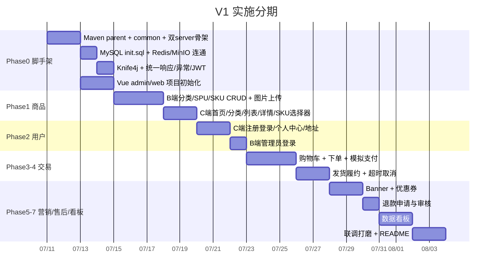

---

## 9. V2 扩展预留

V1 无需实现以下能力，但数据模型和架构为其预留扩展点：

| V2 AI 能力 | V1 预留 |
|------------|---------|
| 智能导购 | 商品描述完整、分类体系清晰 |
| 搜索&推荐 | 搜索接口已有（MySQL LIKE），可扩展搜索日志表 |
| 智能客服 | 商品/订单/FAQ 结构化数据齐全 |
| AI 智能工单 | 退款单表可扩展对话记录字段 |

---

## 附录 A：预置数据

```sql
-- 预置管理员账号（密码 admin123 的 BCrypt 哈希）
INSERT INTO t_admin (username, password, nickname, status, create_time)
VALUES ('admin', '$2a$10$...', '超级管理员', 1, NOW());
```

> 完整建表语句与预置数据见 `docs/sql/init.sql`（实施 Phase 0 时生成）。
