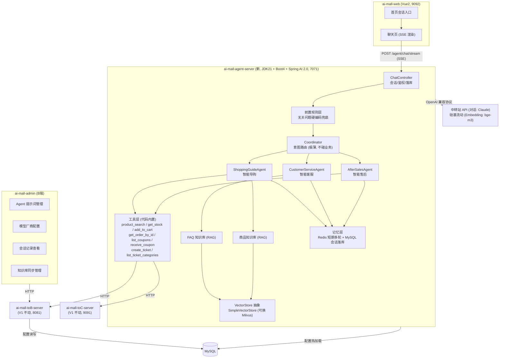
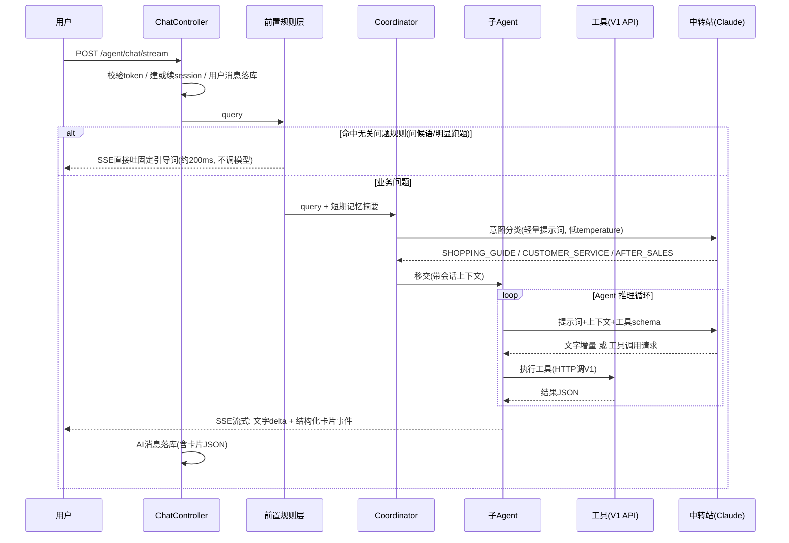
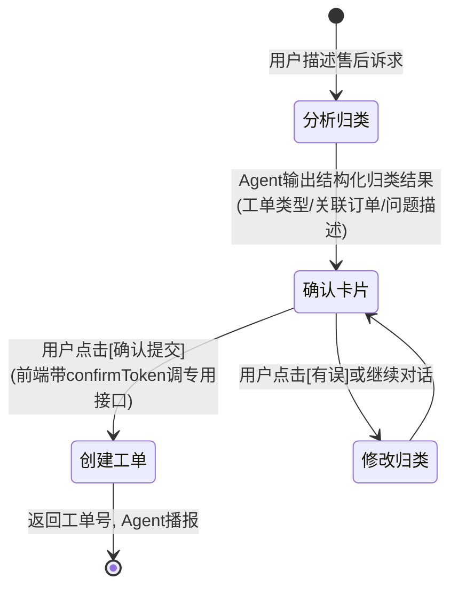
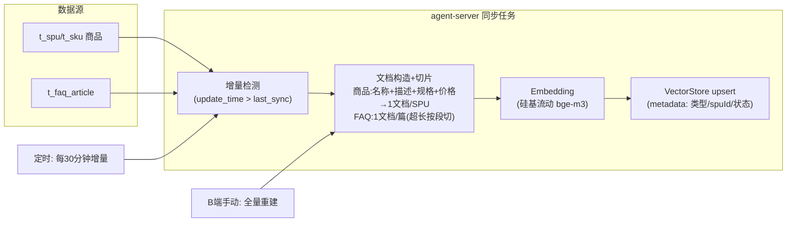

# ai-mall V2 技术方案 —— AI 导购智能体

> 版本：v1.0（2026-07-17）
> 状态：方案确认稿
> 关联决策：独立工程 / SimpleVectorStore 起步 / 中转站 Claude / 提示词+模型动态管理 / 售后开单需用户确认

---

## 0. 一图总览



---

## 1. 需求范围

在 V1 电商闭环之上，首页新增 AI 会话入口，一个对话框内完成三类场景：

| 场景 | 能力 | 数据来源 | 输出形态 |
|---|---|---|---|
| 智能导购 | 按用户问询推荐商品 | 商品库（t_spu/t_sku） | 文字 + **商品卡片** + 快捷提问 |
| 智能客服 | 政策/使用问题解答 | FAQ 库（t_faq_article） | 文字（RAG 引用 FAQ） |
| 智能售后 | 分析归类售后诉求，自动发起工单 | 工单分类（t_service_category/issue）、订单 | 归类确认卡片 → **用户确认后**创建工单 |

明确不做（本期）：长期记忆（跨会话用户偏好）、语音/图片输入、人工客服转接、多语言。

---

## 2. 工程形态

### 2.1 新工程 ai-mall-agent-server

| 项 | 决策 | 原因 |
|---|---|---|
| 位置 | git 仓库根下平级目录，**不加入根 pom 的 modules** | 父 pom 锁 Java 11 + Boot 2.6.15，与 Boot 4 的 BOM 无法共存一棵继承树 |
| parent | `spring-boot-starter-parent` 4.x 直连 | 同 ai-mall-admin/web 的"同仓不同构建"模式 |
| JDK | 21（`maven.compiler.release=21`） | Spring AI 2.0 GA（2026-06-12）要求 Boot 4 + JDK 17 底线、21 推荐 |
| 端口 | 7071 | toB 8081 / toC 9091 各占一段 |
| 接口前缀 | `/agent/*` | 与 `/admin/*`、`/api/*` 并列 |
| 包名 | `com.aimall.agent` | |
| 与 V1 关系 | **只走 HTTP，不共享代码**（不依赖 ai-mall-common） | 解耦边界：Agent 侧只对 V1 的 API 契约负责，V1 内部改动不穿透 |

构建方式：根目录 `mvn package` 行为不变（V1 三模块，JDK 11）；`cd ai-mall-agent-server && mvn package` 用 JDK 21。IDEA 中给该模块单独指定 SDK，两套 JDK 共存无冲突。

### 2.2 技术栈

```
Spring Boot 4.x + Spring AI 2.0（GA）
├── spring-ai-starter-model-openai      ← 两个 OpenAI 兼容 provider
│     对话: 中转站 claude-sonnet-4-6（可 B 端切换，百炼免费额度可录为备用厂商）
│     Embedding: 硅基流动 BAAI/bge-m3（长期免费，1024 维；中转站无 /v1/embeddings 端点）
├── SimpleVectorStore                   ← 起步向量库（面向 VectorStore 抽象，可换 Milvus）
├── Redis                               ← 短期记忆（多轮上下文）+ 配置刷新通知
└── MySQL                               ← 会话/消息落库 + Agent 配置 + 模型配置
```

> **为什么用 OpenAI starter 接 Claude？** 中转站统一转 OpenAI 的 `/v1/chat/completions` 协议格式，Spring AI 的 Anthropic starter 走 Anthropic 原生协议（`/v1/messages`），中转站通常不转。OpenAI starter 允许自定义 `base-url` + 任意 `model` 字符串，填 Claude 型号即可。
>
> **为什么 Embedding 选硅基流动 bge-m3 而不是百炼？** 中转站只有对话模型没有 embeddings 端点，须另接 provider。百炼免费额度 90 天过期，而 Embedding 是持续消耗（每次用户提问的 query 都要向量化）；且 Embedding 模型须"从一而终"——换模型 = 向量空间作废 = 全量重建知识库。硅基流动 bge-m3 长期免费（仅限频率，对本项目量级无感）、OpenAI 兼容（`https://api.siliconflow.cn/v1/embeddings`），无到期迁移炸弹。讯飞星辰 MaaS 的 Qwen3-Embedding-8B 模型虽更强，但官方确认"免费可能随时切换收费"——对有状态的 Embedding 是引信未知的到期炸弹，同理不选。
>
> **备用对话厂商**（录入 t_ai_model_provider，演练 B 端切换与连通性测试）：硅基流动 Qwen/Qwen3-8B（同 Embedding 一个 Key，免费；**P2 实验用它跑 Coordinator 意图分类的首选**——三选一简单任务小模型可能够用，成本更低更快）、讯飞星辰 MaaS（Qwen3.5-2B，免费不限频但官方确认可能随时收费）、阿里百炼（免费额度 90 天内有效）。对话模型无状态，备用厂商收费即切走，无历史包袱。

---

## 3. 【第一课】没有 AI 背景也能看懂的核心概念

> 本节是给你的知识地基，后续每个设计决策都会回指这里。实现阶段我会在写每一块代码时继续深讲。

### 3.1 Embedding 是什么

Embedding（向量化）是把一段文字变成一串数字（如 1536 维的浮点数组），使得**语义相近的文字在数字空间里距离也近**。

```
"四人位的布艺沙发"   → [0.12, -0.83, 0.45, ...]  ┐
"适合一家人坐的沙发"  → [0.11, -0.79, 0.48, ...]  ┘ 距离近（语义像）
"退货运费谁承担"     → [-0.91, 0.22, -0.33, ...]    距离远
```

为什么需要它：用户问"适合一家四口的沙发"，数据库 `LIKE '%四口%'` 一个都搜不到——关键词不匹配但语义匹配。Embedding 让"按意思搜"成为可能。这是 V1 的 `t_hot_search` + LIKE 搜索做不到的。

**对话模型和 Embedding 模型是两个东西**：前者生成文字（Claude 擅长），后者产出向量（Anthropic 压根不提供，须用 OpenAI 的 text-embedding 系列或 bge-m3 等开源模型）。这就是我们"对话用中转站 Claude、Embedding 用硅基流动 bge-m3"混搭的原因。另一个重要性质：**Embedding 模型须从一而终**——不同模型的向量空间互不兼容（维度都不同），中途换模型必须全量重建知识库。

### 3.2 知识库 / RAG / 为什么要"同步"

**知识库**：切成小块并向量化后的领域资料集合。我们有两个——FAQ 知识库（几十篇文章）和商品知识库（几百个 SPU 的名称/描述/规格/价格拼成的文档）。

**RAG（Retrieval-Augmented Generation，检索增强生成）** 三步：
1. 用户问题 → Embedding → 在向量库里找最相近的 top-K 条知识
2. 把这几条知识塞进提示词："请根据以下资料回答……"
3. 模型基于资料生成回答

为什么不直接把所有 FAQ 塞给模型？三个原因：上下文窗口有限且贵（按 token 计费）；资料越多模型幻觉概率越高（参考方案团队的"主要天坑"原话：给模型的知识一定要**准确、完整、结构化**）；RAG 能溯源（知道答案引用了哪条 FAQ）。

**为什么要同步**：向量库是商品/FAQ 数据的"副本"。B 端改了商品价格、新增了 FAQ，向量库不会自动知道——必须重新切片→Embedding→写入。我们的同步机制见 §6.3。

### 3.3 向量库为什么不用 AWS KnowledgeBase，用什么替代

参考方案用的 Bedrock KnowledgeBase 是 AWS 托管服务（绑 AWS 生态、按量计费、不可本地跑）。它本质 = 向量库 + 自动同步管道的打包。**完全可替代**，开源等价物：Milvus、Qdrant、pgvector、Redis Stack、Elasticsearch。

我们起步用 Spring AI 内置的 **SimpleVectorStore**（内存 + JSON 文件持久化，零部署），因为全量数据 Embedding 之后也就几 MB。关键是代码面向 `VectorStore` 接口编程——将来量级上来换 Milvus，只改一个 Bean 定义 + 配置，业务代码零改动。这是"面向抽象"在 AI 工程里的直接兑现。

### 3.4 多 Agent 怎么协同

我们的协同模式是 **Router 模式**（参考方案同款）：Coordinator 只做一次意图分类（一次小请求，快），然后把对话完整移交给选中的子 Agent，由子 Agent 带着自己的提示词+工具集完成本轮。

为什么不是一个"超级 Agent"带全部工具？参考方案的实测数据：单 Agent + 20 工具的工具调用准确率约 78%，拆成 5 个各带 4-6 工具后升到约 93%；上下文峰值从 18K token 降到 5K。**LLM 面对的工具越少，选得越准**。我们 3 个子 Agent 各带 3-5 个工具，正落在甜区。

协同的铁律（参考方案原话）：**Coordinator 一旦开始"懂业务"，它就会重新变慢**。它不调用任何业务工具。

### 3.5 记忆怎么分层

| 层 | 内容 | 存储 | 生命周期 |
|---|---|---|---|
| 短期记忆 | 本会话最近 N 轮对话（喂给模型的上下文） | Redis，key=`agent:mem:{sessionId}` | 会话 TTL（30 分钟滑动） |
| 会话持久化 | 全部消息（刷新后可回显历史） | MySQL `t_ai_session`/`t_ai_message` | 永久 |
| 长期记忆 | 跨会话用户偏好（"上次你看的沙发"） | —— | **本期不做** |

不做长期记忆是参考方案团队用真金白银换来的结论：偏好抽取要额外调一次模型（加耗时）、流量不够时没有回访用户让它产生价值。表结构预留，等业务跑起来再开。

### 3.6 Function Calling（工具调用）是什么

模型本身不能查库存、不能下单。工具调用的机制：我们把每个工具的名称+功能描述+参数 schema 告诉模型，模型在需要时输出"我要调 get_product_stock，参数 {skuId: 3}"，**框架**（Spring AI）拦截这个输出、执行我们写的 Java 方法、把结果喂回模型继续生成。模型永远只是"提出请求"，执行权在我们代码里——这也是为什么售后开工单可以强制加"用户确认"关卡（§5.4）。

MCP 与它的关系：MCP 是把工具放到独立进程/服务、用标准协议连接的方式（参考方案为了多团队解耦用了 MCP）。我们单人开发、工具就是调自己 V1 的 HTTP API，包一层 MCP 纯属自找运维负担——所以按你的要求**工具代码内置**，用 Spring AI 的 `@Tool` 注解直接写在工程里。

---

## 4. Agent 设计

### 4.1 意图路由全链路



### 4.2 三个子 Agent

| | ShoppingGuideAgent | CustomerServiceAgent | AfterSalesAgent |
|---|---|---|---|
| 职责 | 理解需求→检索商品→分层推荐 | 基于 FAQ 知识库答疑 | 售后诉求归类→引导确认→开工单 |
| 工具 | `product_search`（向量+关键词混合检索）、`get_product_stock`、`add_to_cart`、`list_coupons`、`receive_coupon` | `search_faq`（RAG 检索）、`get_order_by_id` | `get_order_by_id`、`list_ticket_categories`、`create_ticket` |
| 知识库 | 商品知识库 | FAQ 知识库 | —— |
| 输出 | 文字 + 商品卡片 + 快捷提问 | 文字（附 FAQ 来源） | 文字 + 工单确认卡片 |
| 写操作 | add_to_cart / receive_coupon（低风险，直接执行并提示） | 无 | create_ticket（**必须用户确认**） |

提示词框架（存 `t_ai_agent_config`，B 端可编辑）统一结构，借鉴你给的客服-agent.md：角色定位 → 上下文记忆要求 → 核心能力 → 服务原则 → 回答规范 → 特殊情况处理 → 禁止行为。导购 Agent 额外吸收场景梳理文档的精华：共情开场 + 分层推荐（2-3 层、每层 2-3 品）+ 总结提炼 + 快捷追问。

### 4.3 售后两阶段确认（写操作防误触）



关键设计：`create_ticket` 工具**不暴露给模型自由调用**。Agent 只产出 `ticket_confirm` 卡片事件（含归类草稿），真正创建走前端确认后的独立接口 `/agent/ticket/confirm`——把"最后一公里"从概率世界（LLM）收回到确定性世界（代码）。

### 4.4 无关问题兜底

参考方案实测：无关问题走 LLM 链路 3s，硬编码 200ms。规则层（正则/关键词白名单）拦截问候语、明显跑题（天气/写诗），直接吐固定引导词 + 三个快捷提问。原则照抄：**能规则化的不调模型，能硬编码的不用 RAG**。

---

## 5. 接口与 SSE 协议

### 5.1 接口清单（C 端，`/agent/*`，复用 V1 的 JWT）

| 接口 | 方法 | 说明 |
|---|---|---|
| `/agent/chat/stream` | POST (SSE) | 流式对话，body: `{sessionId?, message}`，sessionId 空则新建会话 |
| `/agent/chat/stop` | POST | 停止当前生成 |
| `/agent/session/list` | GET | 我的会话列表 |
| `/agent/session/{id}/messages` | GET | 历史消息（分页，刷新回显用） |
| `/agent/ticket/confirm` | POST | 售后工单确认创建（两阶段的第二阶段） |

（接口形态对齐 rsearch 的 AiAssistantApi：chatStream/chatStop/historyMessages/sessionStatusUpdate。）

### 5.2 SSE 事件协议（简化自参考方案的 Vercel AI Stream 思路）

```
data: {"type":"start","messageId":"m-01"}
data: {"type":"agent","name":"SHOPPING_GUIDE"}                       ← 路由结果(前端可展示"导购助手为您服务")
data: {"type":"text-delta","delta":"为您找到几款适合四口之家的沙发："}
data: {"type":"card","cardType":"product_list","data":{"sections":[
        {"title":"推荐首选","products":[{"spuId":1,"name":"...","price":849.99,"image":"...","stock":120}]}]}}
data: {"type":"card","cardType":"ticket_confirm","data":{"draftId":"d-01","categoryName":"退换货","issueName":"商品破损","orderNo":"...","description":"..."}}
data: {"type":"suggest","questions":["这几款哪个更耐脏？","有优惠券可以领吗？"]}
data: {"type":"finish","messageId":"m-01"}
data: [DONE]
```

设计要点：**商品卡片/工单确认卡走独立的结构化 `card` 事件**，不让模型吐 markdown 表格由前端猜着解析——模型负责挑选商品 ID 和推荐语，卡片数据由后端用 ID 反查 V1 API 组装（价格/图片/库存保证准确，杜绝模型幻觉出错价）。

### 5.3 前端（ai-mall-web）

- 首页：悬浮会话入口（PC 右下角气泡 / M 端底部），样式对标 Homie 截图（欢迎语 + 快捷提问 + 输入框）
- 聊天页：SSE 增量渲染、商品卡片（点击跳商详/加购）、工单确认卡（确认/修改按钮）、历史会话回显
- 无 EventSource POST 问题：用 `fetch` + `ReadableStream` 解析 SSE（Vue2 下成熟做法）

---

## 6. 数据设计

### 6.1 会话与消息（参考 rsearch 表结构裁剪）

```sql
CREATE TABLE t_ai_session (
    id BIGINT AUTO_INCREMENT PRIMARY KEY,
    session_id VARCHAR(64) NOT NULL COMMENT '会话ID(UUID)',
    user_id BIGINT NOT NULL,
    title VARCHAR(128) COMMENT '会话标题(首条用户消息截断)',
    status VARCHAR(16) NOT NULL DEFAULT 'ACTIVE' COMMENT 'ACTIVE/CLOSED',
    last_active_time DATETIME,
    create_time DATETIME DEFAULT CURRENT_TIMESTAMP,
    update_time DATETIME DEFAULT CURRENT_TIMESTAMP ON UPDATE CURRENT_TIMESTAMP,
    UNIQUE KEY uk_session_id (session_id), KEY idx_user (user_id)
) ENGINE=InnoDB DEFAULT CHARSET=utf8mb4 COMMENT='AI会话';

CREATE TABLE t_ai_message (
    id BIGINT AUTO_INCREMENT PRIMARY KEY,
    message_id VARCHAR(64) NOT NULL,
    request_message_id VARCHAR(64) COMMENT '关联的用户请求消息ID',
    session_id VARCHAR(64) NOT NULL,
    user_id BIGINT NOT NULL,
    role VARCHAR(16) NOT NULL COMMENT 'user/assistant',
    agent_code VARCHAR(32) COMMENT '回答方: SHOPPING_GUIDE/CUSTOMER_SERVICE/AFTER_SALES/RULE',
    status VARCHAR(16) NOT NULL DEFAULT 'COMPLETED' COMMENT 'GENERATING/COMPLETED/STOPPED/FAILED',
    content TEXT COMMENT '文字内容',
    cards_json TEXT COMMENT '结构化卡片JSON(商品卡/工单确认卡)',
    token_usage INT COMMENT '消耗token数',
    completed_time DATETIME,
    create_time DATETIME DEFAULT CURRENT_TIMESTAMP,
    UNIQUE KEY uk_message_id (message_id), KEY idx_session (session_id)
) ENGINE=InnoDB DEFAULT CHARSET=utf8mb4 COMMENT='AI消息';
```

### 6.2 Agent 配置与模型配置（B 端动态管理）

```sql
CREATE TABLE t_ai_agent_config (
    id BIGINT AUTO_INCREMENT PRIMARY KEY,
    agent_code VARCHAR(32) NOT NULL COMMENT 'COORDINATOR/SHOPPING_GUIDE/CUSTOMER_SERVICE/AFTER_SALES',
    agent_name VARCHAR(64) NOT NULL,
    system_prompt TEXT NOT NULL COMMENT '系统提示词(B端可编辑,热生效)',
    temperature DECIMAL(3,2) DEFAULT 0.70,
    model_provider_id BIGINT COMMENT '指定模型,空则用默认',
    enabled TINYINT NOT NULL DEFAULT 1,
    version INT NOT NULL DEFAULT 1 COMMENT '每次编辑+1',
    create_time DATETIME DEFAULT CURRENT_TIMESTAMP,
    update_time DATETIME DEFAULT CURRENT_TIMESTAMP ON UPDATE CURRENT_TIMESTAMP,
    UNIQUE KEY uk_agent_code (agent_code)
) ENGINE=InnoDB DEFAULT CHARSET=utf8mb4 COMMENT='Agent配置';

CREATE TABLE t_ai_agent_config_history (
    id BIGINT AUTO_INCREMENT PRIMARY KEY,
    agent_code VARCHAR(32) NOT NULL,
    version INT NOT NULL,
    system_prompt TEXT NOT NULL,
    operator VARCHAR(64),
    create_time DATETIME DEFAULT CURRENT_TIMESTAMP,
    KEY idx_agent (agent_code)
) ENGINE=InnoDB DEFAULT CHARSET=utf8mb4 COMMENT='提示词版本历史(可回滚)';

CREATE TABLE t_ai_model_provider (
    id BIGINT AUTO_INCREMENT PRIMARY KEY,
    provider_name VARCHAR(64) NOT NULL COMMENT '如: 中转站-Claude',
    base_url VARCHAR(256) NOT NULL,
    api_key VARCHAR(512) NOT NULL COMMENT 'AES加密存储',
    chat_model VARCHAR(64) NOT NULL COMMENT '如 claude-sonnet-4-6',
    embedding_model VARCHAR(64) COMMENT '如 BAAI/bge-m3',
    is_default TINYINT NOT NULL DEFAULT 0,
    enabled TINYINT NOT NULL DEFAULT 1,
    create_time DATETIME DEFAULT CURRENT_TIMESTAMP,
    update_time DATETIME DEFAULT CURRENT_TIMESTAMP ON UPDATE CURRENT_TIMESTAMP
) ENGINE=InnoDB DEFAULT CHARSET=utf8mb4 COMMENT='模型厂商配置(可切换Claude/GPT)';
```

热生效机制：agent-server 本地缓存配置，B 端保存时向 Redis 发 `agent:config:refresh` 通知（pub/sub），agent-server 订阅后重载；兜底每 60s 轮询 version。**api_key 加密入库**（AES，密钥走环境变量）——延续"敏感信息不明文"约定。

### 6.3 知识库同步



- 元数据带 `status`，下架商品/隐藏 FAQ 在检索时过滤（不用即时删向量）
- 同步记录表 `t_ai_kb_sync_log`（批次/条数/耗时/状态），B 端可看
- 数据获取走 V1 的内部查询 API（toB 加两个只读接口，服务间调用带内部 token）

---

## 7. B 端管理页（ai-mall-admin 新增）

| 页面 | 功能 |
|---|---|
| Agent 管理 | 4 个 Agent 的提示词编辑（大文本框+保存即热生效）、temperature、启停；版本历史与一键回滚 |
| 模型配置 | 厂商增删改、默认切换、连通性测试按钮（发一条 ping 消息验证 key 可用） |
| AI 会话 | 会话列表（按用户/时间筛）、消息明细查看（含卡片渲染、token 消耗）——运营排查 badcase 的主入口 |
| 知识库 | 同步状态、手动全量重建按钮、最近同步日志 |

> 提示词动态化是运行期纠错的刚需：发现 Agent 答跑偏，B 端改提示词保存即生效，不用重新发版。版本历史让每次调整可追溯、可回滚——这正是"把 Agent 当成可运营的产品而不是一段代码"。

---

## 8. 实施分期

| 期 | 内容 | 验收标志 |
|---|---|---|
| P1 | 工程搭建 + 中转站接通 + 会话/消息落库 + CustomerServiceAgent（FAQ RAG 最小闭环）+ 前端聊天页基础版 | 首页入口能问答 FAQ 问题并流式回显、刷新后历史还在 |
| P2 | 商品知识库同步 + ShoppingGuideAgent + 商品卡片/快捷提问 + Coordinator 路由 + 无关问题兜底 | "四人沙发推荐"返回商品卡片可点击加购 |
| P3 | AfterSalesAgent + 工单确认卡 + `/agent/ticket/confirm` 两阶段创建 | 对话中完成一次带确认的工单创建 |
| P4 | B 端四个管理页 + 配置热生效 + 同步管理 | B 端改提示词后下一轮对话生效 |

每期独立可上线。学习主线映射：P1 学 RAG/Embedding/SSE，P2 学多 Agent 协同/工具调用/混合检索，P3 学写操作管控/结构化输出，P4 学 AI 系统的可运营性。

---

## 9. 风险与对策

| 风险 | 对策 |
|---|---|
| 中转站不稳定/限流 | 客户端超时+重试；SSE 层捕获异常吐 `error` 事件给前端友好提示；B 端可快速切备用厂商 |
| 模型幻觉报错价格/库存 | 卡片数据由后端按 ID 反查 V1 组装，模型只出 ID 和推荐语（§5.2） |
| 提示词被改坏 | 版本历史一键回滚（§6.2） |
| Token 成本失控 | 每条消息记 token_usage；短期记忆只带最近 N 轮；无关问题不进模型 |
| 越权 | 工具层强制注入当前登录 userId（订单/工单/购物车只能操作自己的），不信任模型传参 |

---

## 10. 参考资料

- 内部：AI导购核心用户场景梳理.docx / ai导购-算法技术方案.docx / AI 导购·技术分享.docx / 客服-agent.md（提示词框架）；rsearch-web-service 的 AiShoppingSession/AiShoppingMessage 表设计
- [Spring AI 2.0.0 GA Available Now（2026-06-12）](https://spring.io/blog/2026/06/12/spring-ai-2-0-0-GA-available-now/)
- [Spring Boot 4 and Spring AI 2.0: The New Java AI Stack](https://medium.com/@chrisvanbreeden/spring-boot-4-and-spring-ai-2-0-the-new-java-ai-stack-58e9577e7919)
- [Spring AI 2.0 RC Released: Migration Guide](https://www.besthub.dev/articles/spring-ai-2-0-rc-released-migration-guide-new-features-and-langchain4j-comparison-f10aff30a6bf)
